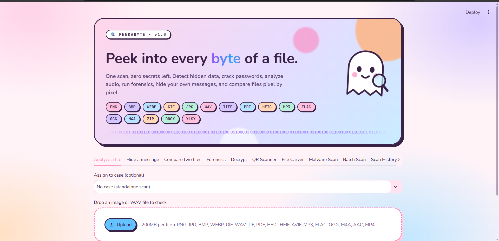

# PeekaByte
**Steganography Detection & Digital Forensics Toolkit**

PeekaByte is an all-in-one forensic analysis tool that detects hidden messages inside images, cracks encrypted files, scans QR codes for fraud, carves deleted files, and much more. Built for cybersecurity professionals, students, and researchers.

---

## Features

### 1. Analyze
Upload any image and run multiple steganography detection tests including LSB (Least Significant Bit) analysis, Chi-Square test, RS Analysis, and a trained CNN (Convolutional Neural Network) model. Get a final verdict on whether the image contains hidden data.

### 2. Hide Message
Hide secret text messages inside images using LSB steganography. Supports optional password protection for added security.

### 3. Compare
Upload two images side by side and compare them visually and statistically to spot differences that may indicate hidden data or tampering.

### 4. Forensics
Extract detailed metadata and EXIF data from images. Useful for investigating image origin, camera details, GPS location, timestamps, and modification history.

### 5. Decrypt
Crack password-protected files (images with hidden messages, PDFs, ZIP archives) using three methods:
- **Known Password** — enter the password directly
- **Dictionary Attack** — uses a wordlist of 4 million+ common passwords
- **Profile Attack (CUPP)** — generate custom passwords based on a person's name, birthdate, pet name, and other personal details

### 6. QR Scanner
Scan QR codes and analyze the URLs for phishing indicators, suspicious domains, and fraud patterns. Helps identify fake payment QR codes and scam links.

### 7. File Carver
Recover and extract embedded files hidden inside other files. Detects file signatures (magic bytes) to carve out images, PDFs, ZIPs, and other file types.

### 8. Malware Scan
Scan suspicious files by checking their hash against known malware databases. Helps identify potentially dangerous files.

### 9. Batch Scan
Upload and analyze multiple files at once. Runs steganography detection on all images in bulk and gives a summary report.

### 10. Scan History
View a log of all previous scans with timestamps, verdicts, file sizes, and SHA-256 hashes. Export the history as a PDF report.

### 11. Cases
Organize your forensic investigations into cases. Group related files, add descriptions, and generate full case reports in PDF format.

---

## How to Use

### Windows

1. Download the ZIP from the [Releases](../../releases) section
2. Extract the ZIP file to any folder
3. Double-click `PeekaByte.exe`
4. A terminal window will open — **do not close it**
5. Your browser will open automatically with the tool
6. If it doesn't, go to `http://localhost:8501` manually
7. Start analyzing!

> **Note:** Windows may show a security warning the first time. Click **"More info"** → **"Run anyway"** to continue.

### Linux

The current release is built for Windows. Linux users can run it using Wine:

1. Install Wine: `sudo apt install wine` (Debian/Ubuntu) or `sudo dnf install wine` (Fedora)
2. Download the ZIP from the [Releases](../../releases) section
3. Extract it: `unzip PeekaByte.zip`
4. Run: `wine PeekaByte.exe`
5. Open `http://localhost:8501` in your browser

---

## Tech Stack

- **Language:** Python
- **Frontend:** Streamlit
- **Steganography Detection:** LSB Analysis, Chi-Square Test, RS Analysis
- **Machine Learning:** CNN model trained for stego detection
- **Password Cracking:** Dictionary attack, CUPP-style profile attack
- **File Analysis:** Magic byte detection, metadata extraction, hash comparison

---

## Screenshots

### Preview

### Analyze

### Hide Message

### Compare

### Forensics

### Decrypt

### CUPP (Profile Attack)

### QR Scanner

### File Carver

### Malware Scan

### Batch Scan

### Scan History

### Cases

---

## System Requirements

- Windows 10 or 11
- 4 GB RAM minimum
- No Python installation needed (standalone executable)

---

## Developer

**Beena Siddique**
B.Sc. Cyber Security — Chandigarh Group of Colleges, Landran

- GitHub: [@beena7865](https://github.com/beena7865)
---

## License

This project is proprietary. The executable is provided for personal and educational use only. Redistribution or reverse engineering of the tool is not permitted.
